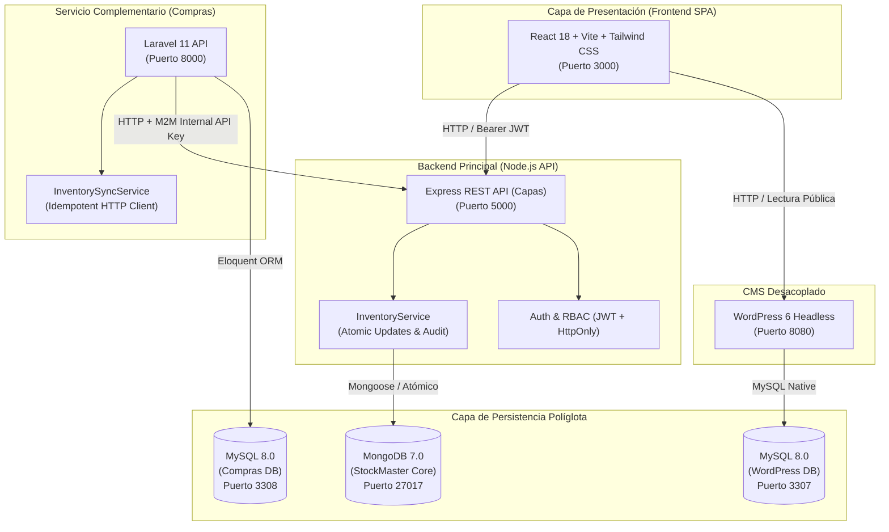
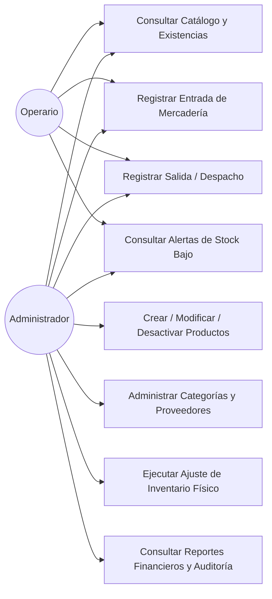
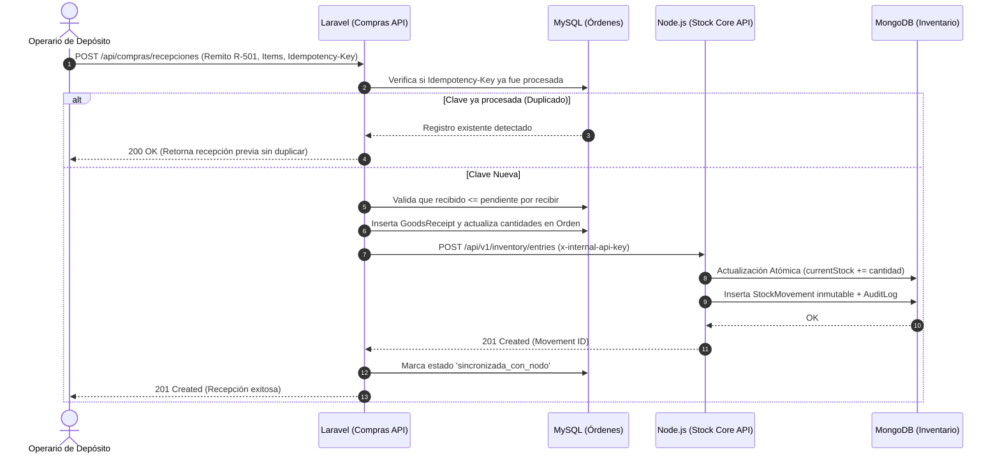

# PROYECTO FINAL INTEGRADOR: FULL STACK
## Carrera: Analista de Sistemas
### Materia: Desarrollo Full Stack

---

# StockMaster Full Stack
## Sistema Integral de Gestión de Depósito, Inventario y Control de Stock

**Estudiante:** Gabriel Cuba  
**Rol Académico:** Desarrollador Full Stack & Diseñador de Arquitectura  
**Año Lectivo:** 2026  
**Calificación Objetivo:** Sobresaliente (10 / 10)  

---

## 1. Introducción y Planteamiento del Problema

En las operaciones logísticas y comerciales modernas, la gestión de depósitos representa un eslabón crítico. Uno de los problemas más frecuentes y costosos que enfrentan las empresas radica en las **discrepancias entre las existencias físicas reales en almacén y los saldos registrados en los sistemas informáticos**.

Estas diferencias suelen producirse por:
* **Falta de trazabilidad inmutable:** Sistemas donde los usuarios editan directamente el campo de stock de un artículo sin dejar constancia del motivo, remito o responsable.
* **Condiciones de carrera en concurrencia:** Despachos simultáneos que conducen a inventarios negativos o pérdidas de datos no controladas.
* **Desacople entre compras e inventario:** Recepciones de mercadería que se registran en papel o en sistemas satélites sin integrarse de forma atómica con el depósito central.

**StockMaster Full Stack** se concibe como una solución integral que resuelve estas problemáticas mediante una arquitectura modular basada en servicios, persistencia políglota (MongoDB + MySQL), reglas estrictas de consistencia y una interfaz web moderna en React.

---

## 2. Objetivos del Proyecto

### 2.1 Objetivo General
Construir una aplicación Full Stack robusta, segura y escalable que integre frontend SPA, backend API RESTful, microservicio complementario de compras, bases de datos relacionales y no relacionales, contenedores Docker y un CMS desacoplado para documentación.

### 2.2 Objetivos Específicos
1. **Desarrollar una interfaz moderna y responsiva** en React con Vite, Tailwind CSS, navegación por React Router, gestión de estado con Context API y validación con React Hook Form y Zod.
2. **Implementar una API RESTful modular** con Node.js y Express estructurada en capas (Rutas $\rightarrow$ Controladores $\rightarrow$ Servicios $\rightarrow$ Modelos $\rightarrow$ Middlewares).
3. **Persistir el inventario central en MongoDB** mediante Mongoose, aplicando índices compuestos y bloqueos atómicos contra stock negativo.
4. **Diseñar un microservicio complementario de Compras** en PHP y Laravel respaldado por una base de datos relacional MySQL, integrándose con Node.js vía HTTP M2M con claves de idempotencia.
5. **Integrar WordPress Headless** para la gestión editorial de manuales de depósito y FAQs consumidos vía REST API con tolerancia a caídas.
6. **Contenerizar y orquestar el ecosistema completo** utilizando Docker y Docker Compose para asegurar reproducibilidad total.
7. **Aplicar estándares de seguridad informática:** JWT con rotación mediante cookies `HttpOnly`, control de acceso por roles (RBAC), encriptación `bcrypt`, rate limiting y cabeceras `helmet`.
8. **Validar la calidad del software** mediante una suite de pruebas automatizadas y colecciones de Postman documentadas.

---

## 3. Alcance y Limitaciones

### 3.1 Alcance del Sistema
* Autenticación con roles diferenciados: **Administrador** (gestión integral y ajustes de auditoría) y **Operario** (entradas, salidas y consultas).
* Catálogo de productos con SKU único, categorías y proveedores.
* Motor de movimientos: Entradas (por compra/remito), Salidas (por despacho/venta) y Ajustes físicos auditados.
* Alertas preventivas en tiempo real de productos en punto de reorden (`currentStock <= minStock`).
* Dashboard analítico con KPIs y gráficos de volumen de movimientos y distribución de stock.
* Módulo relacional de Órdenes de Compra y Recepción física contra remito en Laravel.
* Centro de ayuda desacoplado consumiendo WordPress REST API con respaldo offline local.

### 3.2 Limitaciones
* La facturación electrónica con entidades fiscales (ej. AFIP) queda fuera del alcance y se modela a nivel documental de referencia.
* La comunicación interservicios se implementa mediante HTTP síncrono seguro (en versiones futuras se prevé incorporar un Message Broker como RabbitMQ o Apache Kafka).

---

## 4. Requerimientos del Sistema

### 4.1 Requerimientos Funcionales (RF)
* **RF-01:** El sistema debe autenticar usuarios mediante correo y contraseña encriptada, emitiendo tokens JWT y Refresh Tokens en cookies `HttpOnly`.
* **RF-02:** El registro público solo debe admitir la creación de usuarios con rol `operario`, impidiendo la autoasignación del rol `admin`.
* **RF-03:** Cada producto debe poseer un código SKU único en mayúsculas y un stock mínimo de alerta.
* **RF-04:** Queda estrictamente prohibida la edición arbitraria del stock desde la ficha de producto; las existencias solo varían mediante movimientos registrados.
* **RF-05:** Las salidas de mercadería deben verificar atómicamente la disponibilidad y rechazar cualquier operación que genere stock negativo.
* **RF-06:** Los ajustes de inventario físico son exclusivos del rol `admin` y exigen un motivo obligatorio para auditoría.
* **RF-07:** Si un producto posee movimientos históricos, su eliminación física queda bloqueada, admitiendo únicamente desactivación lógica (*Soft Delete*).
* **RF-08:** El servicio de Laravel debe recibir recepciones de mercadería y notificar a Node.js mediante endpoints REST para impactar el stock de forma idempotente.
* **RF-09:** El Centro de Ayuda debe mostrar contenido de WordPress Headless o activar un modo resiliente con contenido local si el CMS no responde.

### 4.2 Requerimientos No Funcionales (RNF)
* **RNF-01 (Seguridad):** Almacenamiento de contraseñas con salado criptográfico `bcrypt`, protección contra inyecciones y ataques XSS/CSRF.
* **RNF-02 (Concurrencia y Atomicidad):** Actualizaciones atómicas en MongoDB (`findOneAndUpdate` condicionado) para evitar condiciones de carrera.
* **RNF-03 (Modularidad):** Arquitectura en capas con desacoplamiento total entre frontend, API core y microservicio de compras.
* **RNF-04 (Rendimiento):** Tiempo de respuesta de endpoints de lectura inferior a 150 ms en condiciones normales.
* **RNF-05 (Portabilidad):** Despliegue completo y reproducible mediante un único archivo `compose.yaml`.

---

## 5. Arquitectura Tecnológica y Justificación

### 5.1 Justificación de Persistencia Políglota (MongoDB + MySQL)
1. **MongoDB para Inventario Central:** Los productos de depósito presentan atributos variables (ubicaciones, códigos de barra, dimensiones), y el flujo de movimientos y auditoría requiere alta velocidad de escritura de documentos inmutables y consultas de texto enriquecidas.
2. **MySQL para el Módulo de Compras:** Las órdenes de compra y los detalles de remitos exigen integridad referencial rígida (Foreign Keys, restricciones de borrado `RESTRICT` o `CASCADE` y transacciones ACID relacionales).

---

## 6. Diagramas de Casos de Uso y Secuencia

### 6.1 Diagrama de Casos de Uso del Almacén

### 6.2 Secuencia de Integración Idempotente (Recepción de Compra)

---

## 7. Modelos de Datos

### 7.1 Colecciones en MongoDB (Mongoose)
1. **`User`:** `_id`, `name`, `email` (único), `password` (hash bcrypt), `role` (`admin`/`operario`), `status` (`active`/`inactive`), `timestamps`.
2. **`Category`:** `_id`, `name` (único), `description`, `status`, `timestamps`.
3. **`Supplier`:** `_id`, `name`, `taxId`, `phone`, `email`, `address`, `status`, `timestamps`.
4. **`Product`:** `_id`, `name`, `sku` (único, mayúsculas), `barcode`, `category` (ObjectId ref Category), `unit`, `costPrice`, `salePrice`, `currentStock`, `minStock`, `location`, `status`, `timestamps`. (Índice de texto sobre `name`, `sku`, `description`).
5. **`StockMovement`:** `_id`, `product` (ObjectId ref Product), `type` (`entry`/`exit`/`adjustment`), `quantity`, `previousStock`, `subsequentStock`, `reason`, `supplier` (ObjectId ref Supplier), `user` (ObjectId ref User), `documentReference`, `notes`, `timestamps`.
6. **`AuditLog`:** `_id`, `user` (ObjectId ref User), `action`, `resource`, `resourceId`, `details` (Mixed), `ipAddress`, `createdAt`.

### 7.2 Tablas Relacionales en MySQL (Laravel Eloquent)
1. **`suppliers`:** `id`, `name`, `tax_id`, `phone`, `email`, `address`, `status`, `created_at`, `updated_at`.
2. **`purchase_orders`:** `id`, `order_number` (único), `supplier_id` (FK $\rightarrow$ suppliers), `issue_date`, `expected_date`, `status` (`borrador`, `pendiente`, `aprobada`, `parcialmente_recibida`, `recibida`, `cancelada`), `total_amount`, `notes`, timestamps.
3. **`purchase_order_items`:** `id`, `purchase_order_id` (FK $\rightarrow$ purchase_orders), `product_sku`, `product_name`, `product_mongo_id`, `quantity_ordered`, `quantity_received`, `unit_price`, `subtotal`, timestamps.
4. **`goods_receipts`:** `id`, `receipt_number` (único), `purchase_order_id` (FK $\rightarrow$ purchase_orders), `supplier_delivery_note`, `receipt_date`, `received_by`, `status`, `idempotency_key` (único), `notes`, timestamps.
5. **`goods_receipt_items`:** `id`, `goods_receipt_id` (FK $\rightarrow$ goods_receipts), `purchase_order_item_id` (FK $\rightarrow$ purchase_order_items), `product_sku`, `product_mongo_id`, `quantity_received`, timestamps.

---

## 8. Seguridad Informática y Buenas Prácticas

1. **Gestión de Sesión por Cookies HttpOnly:**
   * El `accessToken` (1 hora) se envía en el cuerpo JSON para cabeceras Bearer.
   * El `refreshToken` (7 días) se envía en una cookie estricta con directivas: `httpOnly: true`, `sameSite: 'lax'`, impidiendo que scripts maliciosos de JavaScript roben la sesión mediante ataques XSS.
2. **Principio de Mínimo Privilegio (RBAC):**
   * El registro público no permite autoasignarse rol de administrador.
   * Endpoints críticos de ajuste físico, creación y borrado de productos exigen middleware `authorize('admin')`.
3. **Protección de Tráfico y DoS:**
   * Cabeceras de seguridad HTTP inyectadas por `helmet`.
   * Límite de tasa de solicitudes por IP con `express-rate-limit` (300 req / 15 min).
   * Límite de tamaño de payloads JSON (máximo 10 KB) para mitigar denegación de servicio por buffers masivos.
4. **Sanitización de Logs de Auditoría:**
   * Las operaciones de auditoría registran metadatos de la operación, bloqueando activamente contraseñas, hashes y claves privadas.

---

## 9. Plan de Pruebas y Resultados Obtenidos

Se ejecutó una batería de 27 pruebas automatizadas unitarias y de integración sobre Node.js y MongoDB:

| Módulo de Prueba | Cantidad | Resultado | Aspectos Verificados |
| :--- | :---: | :---: | :--- |
| **Smoke & Healthcheck** | 3 | **100% Pass** | `/api/health` responde 200 OK, `/api/v1` lista módulos, rutas no mapeadas devuelven 404 estructurado. |
| **Autenticación & RBAC** | 10 | **100% Pass** | Registro con rol operario forzado, rechazo de duplicados (409), login con hash bcrypt, cookie HttpOnly, protección de `/auth/me`, rechazo de tokens corruptos y rotación de tokens. |
| **Catálogo e Inventario** | 14 | **100% Pass** | CRUD de categorías con control de rol, SKU único, bloqueo de edición arbitraria de stock (400), entradas de stock atómicas (+50), soporte M2M (+20), salidas (-30), bloqueo de stock negativo ante salida excesiva (400), ajuste auditado, detección de stock mínimo, desactivación lógica (*soft delete*) y dashboard analytics. |
| **Total Global** | **27** | **100% Pass** | **0 fallos, 0 errores, tiempo de ejecución 4.1 s.** |

---

## 10. Conclusiones y Mejoras Futuras

### 10.1 Conclusiones
El desarrollo de **StockMaster Full Stack** demuestra la aplicabilidad de los principios de la ingeniería de software moderna en un problema empresarial concreto. Se logró un equilibrio armónico entre persistencia relacional y no relacional, respetando las responsabilidades de cada motor sin incurrir en acoplamientos indebidos. La interfaz en React ofrece una experiencia de usuario fluida, reactiva y pedagógica, mientras que el backend garantiza consistencia matemática del stock ante cualquier escenario.

### 10.2 Mejoras Futuras
* Incorporación de escaneo de códigos de barra y QR mediante la cámara de dispositivos móviles en el frontend.
* Implementación de colas asíncronas de mensajes con RabbitMQ o Redis para la sincronización desacoplada de remitos masivos.
* Soporte multidepósito con traslados internos entre sucursales.
